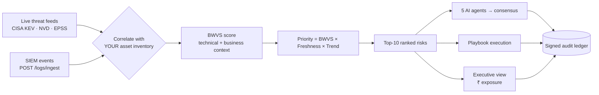
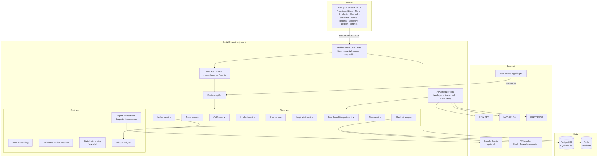
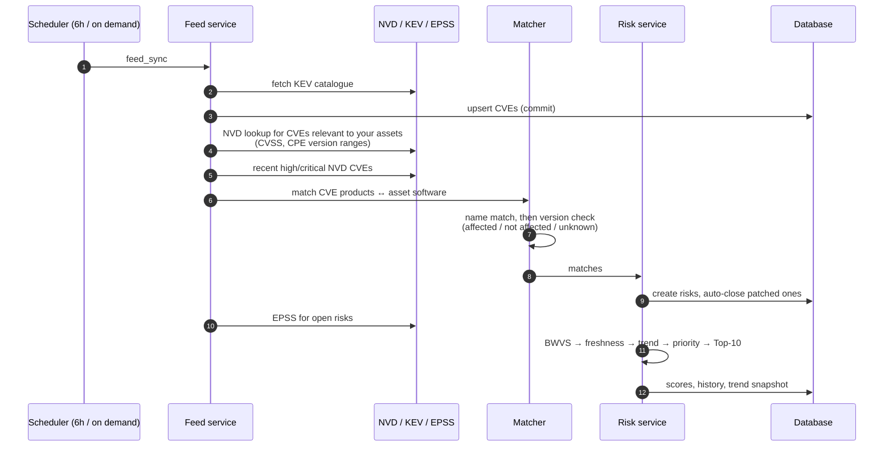
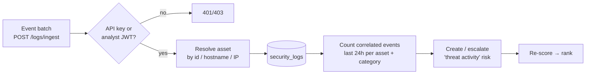
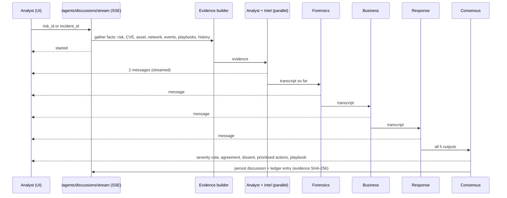
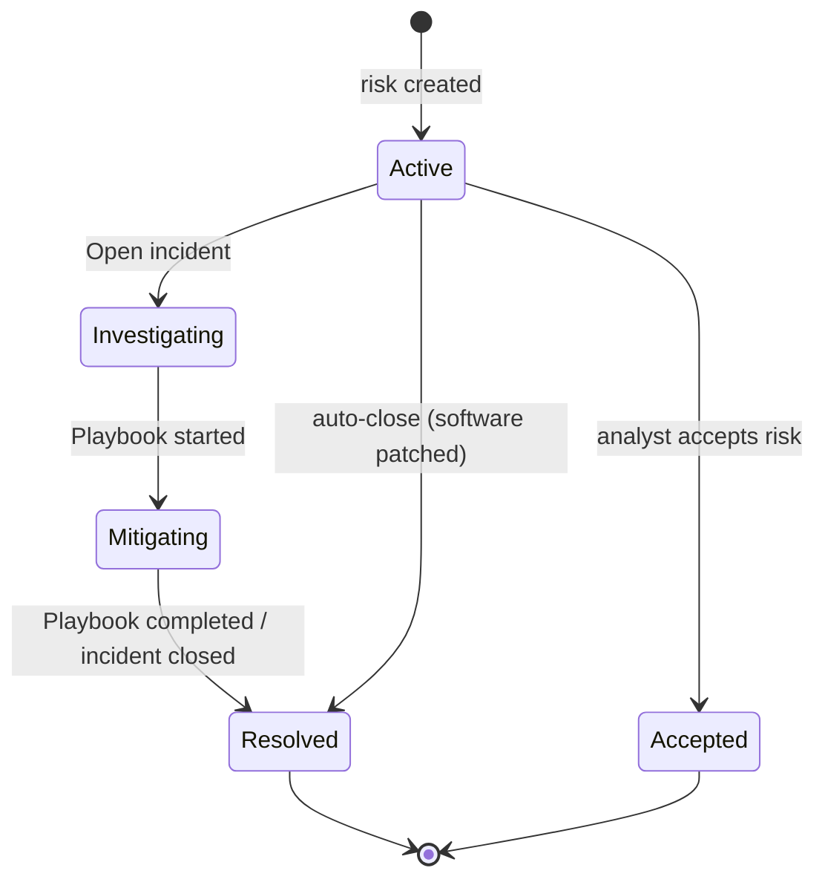
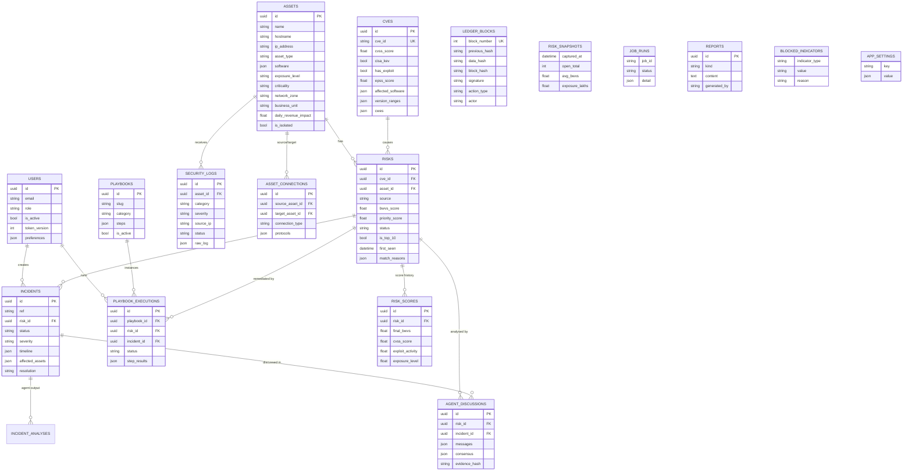

# Contexta

**Autonomous, context-aware threat intelligence and business-risk platform.**
Contexta turns raw vulnerability feeds and security events into a short, ranked list of *the risks that matter to
your business* — with AI-assisted analysis, executable response playbooks and a tamper-evident audit trail.

    

> No mock data. Nothing is pre-loaded or simulated: you add your assets, Contexta pulls live intelligence
> (CISA KEV, NVD, EPSS), and risks appear when the two are correlated.
> The full write-up (problem, solution, novelty, technology choices and comparisons) is in
> **[docs/SOLUTION_DOCUMENT.md](docs/SOLUTION_DOCUMENT.md)**.

---

## Contents
1. [The problem and the idea](#1-the-problem-and-the-idea)
2. [Features](#2-features)
3. [Architecture](#3-architecture)
4. [How it works (workflows)](#4-how-it-works-workflows)
5. [Core engines](#5-core-engines)
6. [Data model](#6-data-model)
7. [Security model](#7-security-model)
8. [Tech stack](#8-tech-stack)
9. [Getting started](#9-getting-started)
10. [Configuration](#10-configuration)
11. [API](#11-api)
12. [Project structure](#12-project-structure)
13. [Testing](#13-testing)
14. [Known limitations](#14-known-limitations)

---

## 1. The problem and the idea

Organisations face thousands of new CVEs a year. CVSS says how bad a flaw is *in general*; it says nothing about
**your** payroll server, whether the flaw is already being **exploited**, or what an outage would **cost**.
Security teams drown in "critical" findings, patch in the wrong order, and cannot explain risk to executives in money.

Contexta ranks risk by **business impact + real-world exploitation + freshness**, explains each risk with a small
team of specialised AI agents, lets analysts execute response playbooks, and records every action in a
cryptographically signed ledger.



## 2. Features

| Area | What you get |
| --- | --- |
| **Live threat intelligence** | CISA KEV catalogue, NVD CVSS/CPE data, FIRST EPSS exploit probability; scheduled + on-demand sync |
| **Version-aware matching** | CVEs are matched to installed software *and checked against NVD affected-version ranges*; patched software is not flagged and stale risks auto-close |
| **BWVS scoring** | Business-Weighted Vulnerability Score (0-100) combining CVSS, exploit activity, exposure, asset criticality, revenue impact and AI relevance |
| **Dynamic ranking** | Priority decays with a 7-day half-life and is boosted by KEV / ransomware / EPSS / rising event volume |
| **Multi-agent analysis** | Analyst, Threat-Intel, Forensics, Business-Impact and Response agents debate in a staged pipeline and reach a consensus; streamed live to the UI |
| **Digital twin** | Network graph from your assets; BFS/DFS attack paths, blast radius, critical paths, ransomware/APT/insider/DDoS simulations with ₹ loss estimates |
| **Playbooks** | 5 response playbooks with automated (isolate, block IOCs, collect evidence, notify, scan) and manual steps; full execution tracking |
| **Incidents** | Opened from a risk, timeline, notes, assignment, closure that can resolve the linked risk |
| **SIEM ingestion** | Authenticated event API; events resolve to assets and create/escalate risks |
| **Executive & reports** | Probability-weighted financial exposure, SLA breaches, trends, board report (LLM or rules-written), CSV export |
| **Audit ledger** | SHA-256 hash chain + Ed25519 signatures; one-click verification; tamper detection incl. actor/event columns |
| **Operations** | Role-based access, rate limiting, background jobs with run history, health probes, Alembic migrations, Docker Compose |

## 3. Architecture



**Design principles**

* **Evidence first.** Every analysis (agent, report, score) is computed from stored facts; the AI never invents data.
* **Degrade gracefully.** No Gemini key → deterministic rules engine over the same evidence. No Redis → in-memory limiter. One failing feed does not stop the others.
* **Assumptions are visible.** Financial figures return the assumptions used (downtime days, exploit-probability rules).
* **Audit everything.** Writes queue ledger entries that are appended only after the transaction commits.

## 4. How it works (workflows)

### 4.1 From feed to ranked risk



### 4.2 Event → risk (SIEM path)



### 4.3 Multi-agent analysis



Each agent receives the **same evidence pack** plus the discussion so far, must cite only that evidence, and answers
with strict JSON (message, severity, confidence, key points, recommendations, structured data). With Gemini configured
the agents are LLM-driven; otherwise each runs a deterministic rules function over the same evidence. If the LLM
fails mid-run the affected agent falls back to rules and is flagged `degraded`.

### 4.4 Risk → incident → playbook → closure



Playbook executions advance automatically through *automated* steps and pause at *manual* steps until an analyst
marks them done or skips them; every step is written to the ledger.

## 5. Core engines

### 5.1 BWVS — Business-Weighted Vulnerability Score

```
BWVS = 10 × ( 0.20·CVSS + 0.20·ExploitActivity + 0.15·Exposure
            + 0.20·AssetCriticality + 0.15·BusinessImpact + 0.10·AIRelevance )     (each term 0-10 → score 0-100)
```

| Component | Source | Scale |
| --- | --- | --- |
| CVSS | NVD | 0-10 |
| Exploit activity | KEV / Exploit-DB / Metasploit = 10, GitHub PoC = 8, other reports = 6, none = 2 | |
| Exposure | internet-facing 10 · VPN 7 · internal 4 · isolated 1 | |
| Asset criticality | payment/payroll 10 · core backend 8 · CRM/HR 6 · dev/test 3 | |
| Business impact | daily revenue impact: >₹10L = 10, 5-10L = 8, 1-5L = 6, <1L = 3 | |
| AI relevance | 90%+ = 10, 75% = 8, 50% = 6, 25% = 4, else 2 | |

Levels: **critical ≥ 80 · high ≥ 60 · medium ≥ 40 · low < 40**.

### 5.2 Dynamic ranking

```
Priority = BWVS × Freshness × Trend
Freshness = 0.5 ^ (days since last new evidence / 7)
Trend     = 1.0 … 2.0   (+0.40 KEV, +0.15 ransomware use, +0.10 public exploit,
                         +0.30×EPSS, +0.05…0.30 rising event volume)
```

### 5.3 Expected financial loss

```
P(asset compromised) = 1 − Π(1 − pᵢ)       pᵢ = EPSS (≥0.5 if KEV; 0.6 if seen in logs; CVSS prior otherwise) × exposure factor
Expected loss        = daily revenue impact × expected downtime days × P
```

### 5.4 Digital twin
Assets and connections form a directed graph (NetworkX). The engine provides BFS/DFS **attack paths**, **blast radius**,
**critical paths** (entry points → critical assets), and probabilistic **lateral-movement simulation** for
ransomware, APT, insider and DDoS scenarios, mapped to MITRE ATT&CK tactics, with downtime/loss from your inventory.

### 5.5 Audit ledger
```
data_hash  = SHA-256(payload)
block_hash = SHA-256(previous_hash + data_hash)
signature  = Ed25519(block_hash)
```
Verification checks every hash, every link, every signature, **and** that the displayed actor / event / resource columns
match the signed payload.

## 6. Data model



Schema is managed by Alembic (`backend/migrations`). 18 tables; development databases created by `create_all` gain new
nullable columns automatically.

## 7. Security model

| Concern | Control |
| --- | --- |
| Authentication | bcrypt password hashes; short-lived JWT access + refresh tokens; `token_version` revokes all tokens on logout / role change / password change / disable; timing-equalised login |
| Authorisation | Role checks in the API (viewer < analyst < admin); every write endpoint verified in tests for viewer and anonymous callers |
| Brute force | Per-IP and per-account login throttles; global rate limit (Redis or memory); `X-Forwarded-For` trusted only when `TRUST_PROXY_HEADERS=true` |
| Injection | SQLAlchemy parameterised queries; strict Pydantic validation; UI renders data as text (no `innerHTML`) |
| SSRF | Webhook targets must resolve to public addresses; redirects disabled |
| Transport / browser | HSTS, CSP, `X-Frame-Options: DENY`, `nosniff`, no-referrer, explicit CORS origins |
| Secrets | Production refuses weak/default secrets, wildcard CORS, debug mode, short admin password; no secrets in the repo |
| Supply chain | Dependencies audited (`pip-audit` clean); non-root containers |
| Integrity | Signed hash-chain ledger with scheduled verification |

## 8. Tech stack

| Layer | Choice | Why (short) |
| --- | --- | --- |
| API | **FastAPI** + Pydantic v2 | async I/O for feed calls and SSE streaming; typed validation; OpenAPI for free |
| ORM / DB | **SQLAlchemy 2 (async)**, **PostgreSQL** (SQLite in dev), **Alembic** | relational integrity, JSON columns, easy local dev, versioned schema |
| Cache | **Redis** (optional) | shared rate-limit counters across replicas |
| Scheduler | **APScheduler** | in-process cron/interval jobs with run history; no extra broker |
| Graph | **NetworkX** | pure-Python graph algorithms; enough for thousands of assets |
| AI | **Google Gemini** behind a small `AIClient` interface | JSON output, long context, generous free tier; swappable |
| Crypto | **Ed25519** + SHA-256 (`cryptography`) | small fast signatures, no parameter pitfalls |
| UI | **Next.js 16 / React 19**, **Tailwind**, **Recharts** | production build tooling, CSP/headers, small client |
| Packaging | Docker Compose (Postgres, Redis, API, web) | one-command deployment |

Detailed comparisons with alternatives are in **[docs/SOLUTION_DOCUMENT.md](docs/SOLUTION_DOCUMENT.md#6-technology-stack--why-this-and-not-that)**.

## 9. Getting started

### Local (SQLite, no Docker)
```bash
# Backend (Python 3.11+)
cd project_cyber/backend
python -m venv venv && source venv/bin/activate      # Windows: venv\Scripts\activate
pip install -r requirements.txt
cp .env.example .env            # set ADMIN_EMAIL / ADMIN_PASSWORD (10+ chars); optional GEMINI_API_KEY, NVD_API_KEY
uvicorn app.main:app --port 8000

# Frontend (Node 18+)
cd project_cyber/frontend
cp .env.example .env.local
npm install && npm run dev                            # http://localhost:3000
```

First steps in the UI: sign in → **Assets** (add/import, include software *with versions*) → wait for / run the feed
sync (**Settings → System**) → review **Top Risks** → run **AI analysis** or a **playbook**.
Connect your SIEM to `POST /api/v1/logs/ingest` to populate **Alerts**.

### Production (Docker Compose)
```bash
cd project_cyber
cp .env.example .env            # fill every REQUIRED value
docker compose up -d --build    # postgres + redis + api (runs alembic upgrade head) + web
```
Put a TLS-terminating reverse proxy in front; set `PUBLIC_API_URL`, `CORS_ORIGINS`, and `TRUST_PROXY_HEADERS=true`
only if the proxy is yours. Run **one** API replica (the scheduler runs in-process).

## 10. Configuration

| Variable | Purpose | Default |
| --- | --- | --- |
| `APP_ENV` | `development` / `test` / `production` | development |
| `SECRET_KEY`, `JWT_SECRET_KEY` | secrets (32+ chars in production) | — |
| `DATABASE_URL` | SQLAlchemy URL | SQLite file |
| `ADMIN_EMAIL`, `ADMIN_PASSWORD` | first administrator | — |
| `GEMINI_API_KEY` | enables LLM agents/reports | unset → rules engine |
| `NVD_API_KEY` | higher NVD rate limit | unset |
| `NVD_ENRICH_PER_SYNC` | CVEs version-enriched per sync | 25 |
| `CVE_FETCH_INTERVAL_HOURS` | feed sync period | 6 |
| `RISK_CALCULATION_INTERVAL_MINUTES` | re-scoring period | 15 |
| `INGEST_API_KEY` | secret for SIEM → `/logs/ingest` | unset |
| `CORS_ORIGINS` | allowed web origins (JSON list) | localhost:3000 |
| `TRUST_PROXY_HEADERS` | honour `X-Forwarded-For` | false |
| `ALLOW_PRIVATE_WEBHOOKS` | permit internal webhook targets | false |
| `EXPECTED_DOWNTIME_DAYS_CRITICAL/DEFAULT` | loss-model assumptions | 3 / 1 |

## 11. API
See **[API_DOCUMENTATION.md](API_DOCUMENTATION.md)** (generated from the OpenAPI schema). Interactive docs at `/docs`
outside production.

## 12. Project structure

```
project_cyber/
├── docker-compose.yml          # Postgres + Redis + API + web
├── backend/
│   ├── app/
│   │   ├── main.py             # app, middleware, lifespan
│   │   ├── config.py           # settings + production validation
│   │   ├── api/routes/         # auth, risks, assets, alerts, incidents, playbooks, agents, twin, ledger, dashboard, admin, cves
│   │   ├── services/           # business logic (risk, feed, matcher, playbook, dashboard, report, ledger …)
│   │   ├── risk_engine/        # BWVS + ranking
│   │   ├── agents/             # 5 agents, evidence builder, orchestrator
│   │   ├── twin/               # digital-twin graph engine
│   │   ├── ledger/             # event types, Ed25519 signing
│   │   ├── ingestion/          # CISA / NVD / EPSS collector
│   │   ├── ai/                 # Gemini client
│   │   ├── models/ schemas/    # SQLAlchemy models, Pydantic schemas
│   │   ├── workers/            # APScheduler jobs
│   │   └── auth/ utils/        # JWT, passwords, rate limit, network helpers
│   ├── playbooks/              # 5 response playbooks (JSON)
│   ├── migrations/             # Alembic
│   └── tests/                  # 100+ unit, API and security tests
└── frontend/
    ├── app/                    # routes: / and /login
    ├── components/             # views + dashboard widgets + modals
    ├── lib/api/                # typed API client (auth refresh, SSE)
    ├── contexts/ hooks/        # auth, theme, data hooks
    └── next.config.js          # security headers, standalone output
```

## 13. Testing
```bash
cd project_cyber/backend && pytest                       # scoring, ledger, API workflows, version matching, security
cd project_cyber/frontend && npx tsc --noEmit && npm run build
```

## 14. Known limitations
* CISA KEV carries no version data; version confirmation depends on NVD lookups (rate-limited without an NVD key), so many matches show *version not verified* until enriched.
* Ledger signing key lives beside the database; export the ledger periodically or keep the key in a secrets manager for strong non-repudiation.
* Webhook delivery, containment actions and SSO are integration points, not bundled connectors.
* AI output is advisory; agents are read-only and never change data.
* Single API replica (in-process scheduler).
