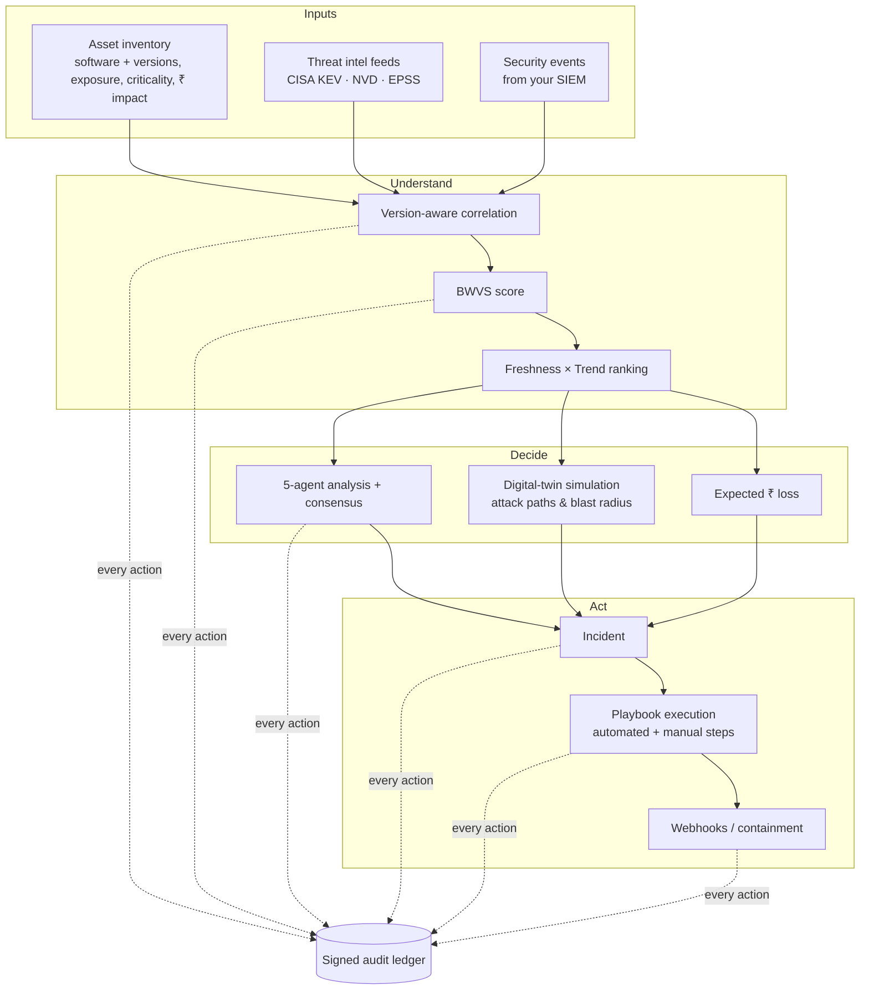
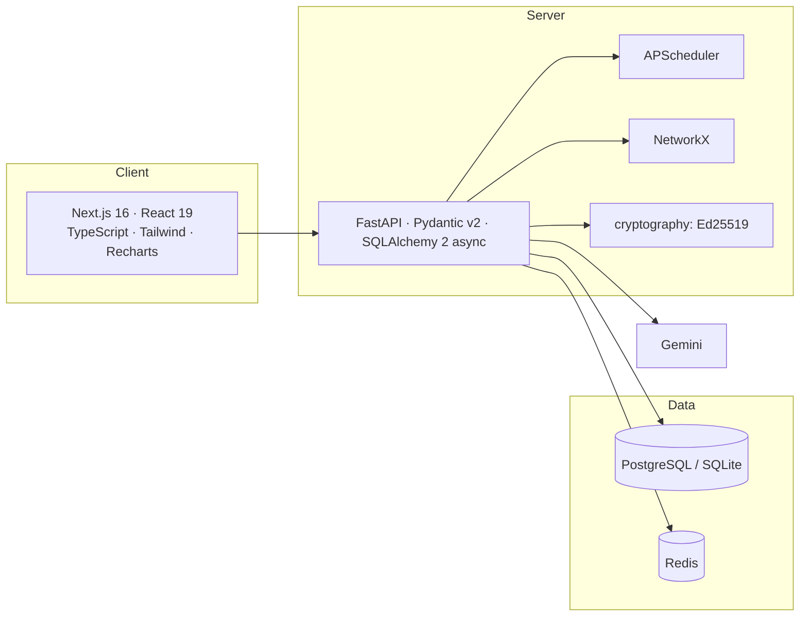
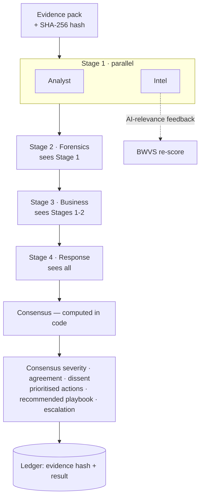
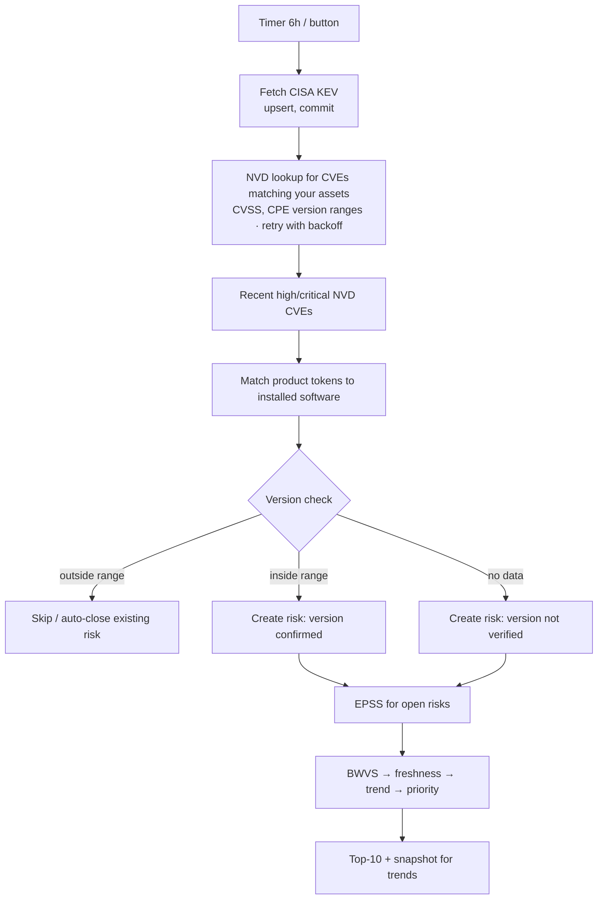
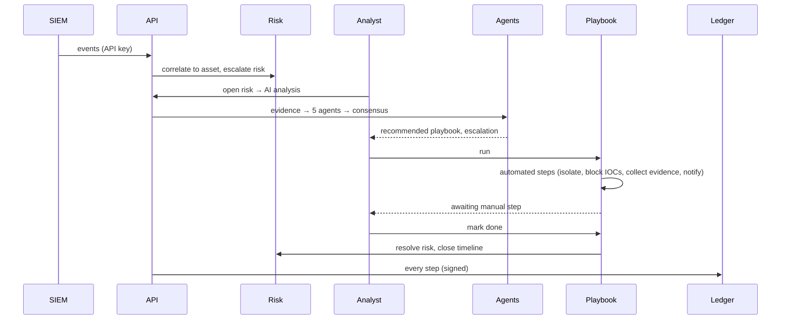
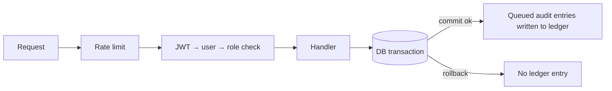

# Contexta — Solution Document

*Problem statement · Solution · Uniqueness · Innovation · Novelty · Technology choices · Agent design · Workflows*

---

## Table of contents
1. [Problem statement](#1-problem-statement)
2. [The solution](#2-the-solution)
3. [How it solves the problem — end to end](#3-how-it-solves-the-problem--end-to-end)
4. [Uniqueness: how Contexta differs from existing tools](#4-uniqueness-how-contexta-differs-from-existing-tools)
5. [Innovation and novelty](#5-innovation-and-novelty)
6. [Technology stack — why this and not that](#6-technology-stack--why-this-and-not-that)
7. [The AI agents — what they are, why, and how they work](#7-the-ai-agents--what-they-are-why-and-how-they-work)
8. [Workflows in depth](#8-workflows-in-depth)
9. [Worked example](#9-worked-example)
10. [Trust, safety and limits](#10-trust-safety-and-limits)
11. [Impact and roadmap](#11-impact-and-roadmap)

---

## 1. Problem statement

### 1.1 The situation
* Tens of thousands of CVEs are published every year. A mid-size company runs hundreds of assets with thousands of software components.
* Scanners and feeds report hundreds or thousands of "critical" or "high" findings. Teams cannot patch them all, so **ordering decides whether the company is breached**.

### 1.2 Why existing practice fails

| Gap | Consequence |
| --- | --- |
| **CVSS is context-free.** A 9.8 on a dev box and a 9.8 on the payroll server look identical. | Effort is spent on the wrong assets. |
| **Exploitation is ignored.** Only a small fraction of CVEs are ever exploited; CISA's KEV list and EPSS say which. | Teams patch theoretical risks while exploited ones stay open. |
| **No version awareness in feeds.** KEV lists "vendor + product", not versions. | Patched systems are flagged → alert fatigue → real alerts ignored. |
| **Risk is not in money.** Executives cannot weigh "CVSS 8.1" against budget. | Security is under-funded or mis-prioritised. |
| **Analysis is manual and inconsistent.** Each analyst reasons differently, undocumented. | Slow response, no shared reasoning, no repeatability. |
| **Response is tribal knowledge.** Runbooks live in wikis. | Steps skipped under pressure; no record of what was done. |
| **Audit trails are mutable.** Logs in a database can be edited. | Weak forensics and compliance evidence. |
| **Tools are siloed.** Scanner, SIEM, ticketing, SOAR and reporting are separate products. | Context is lost between them. |

### 1.3 The problem in one sentence
> *Given my real assets, the live threat landscape and my business, **what should I fix or contain first, why, what will it cost if I don't, what exactly should I do — and can I prove afterwards what was decided and done?***

## 2. The solution

Contexta is a single platform that **correlates your asset inventory with live threat intelligence and security events, scores each risk by business impact and real-world exploitation, explains it with a team of specialised AI agents, drives response through executable playbooks, and seals every decision in a tamper-evident ledger.**

### The five ideas that make it work
1. **Context over severity** — BWVS puts the business (criticality, exposure, revenue) next to technical severity.
2. **Evidence over opinion** — exploitation signals (KEV, EPSS, live events) and freshness drive ranking; scores decay when nothing new happens.
3. **Facts → AI, never AI → facts** — agents receive a frozen evidence pack and must cite it; output is validated JSON.
4. **Closed loop** — risk → analysis → incident → playbook → resolution, with state flowing back (e.g. playbook completion resolves the risk).
5. **Provable history** — every step is hash-chained and signed, so the record can be independently verified.

## 3. How it solves the problem — end to end

| Problem | How Contexta solves it | Where |
| --- | --- | --- |
| Context-free severity | **BWVS** = CVSS + exploit activity + exposure + criticality + revenue impact + AI relevance | `risk_engine/bwvs.py` |
| Exploitation ignored | CISA KEV, EPSS, public-exploit signals raise a **trend factor up to 2×** | `risk_engine/ranking.py` |
| Stale noise | **Freshness half-life of 7 days** since last new evidence | `risk_engine/ranking.py` |
| Patched systems flagged | **Version-range matching** from NVD CPE data; patched assets skipped, stale risks auto-closed | `services/software_matcher.py` |
| Risk not in money | **Probability-weighted ₹ exposure** per asset/business unit with visible assumptions | `services/risk_service.py`, executive view |
| Inconsistent analysis | **5 specialised agents** with fixed roles, shared evidence, consensus | `agents/` |
| "What if we're hit?" | **Digital twin**: attack paths, blast radius, scenario loss | `twin/engine.py` |
| Tribal-knowledge response | **Executable playbooks** with automated and manual steps and tracking | `services/playbook_service.py` |
| Mutable logs | **Ed25519-signed hash chain** + scheduled verification | `services/ledger_service.py` |
| Siloed tools | One workflow from intelligence to closure, one UI | whole system |

## 4. Uniqueness: how Contexta differs from existing tools

| Capability | Vulnerability scanners (Nessus, Qualys, Rapid7) | Threat-intel platforms (MISP, OpenCTI) | SIEM (Splunk, Elastic, Sentinel) | SOAR (XSOAR, Shuffle) | GRC / risk-quant (RiskLens, Archer) | **Contexta** |
| --- | --- | --- | --- | --- | --- | --- |
| Finds vulnerabilities by scanning | ✅ | ❌ | ❌ | ❌ | ❌ | ❌ (uses your inventory + feeds; no scanner needed) |
| Live exploitation intelligence (KEV/EPSS) in ranking | partial / add-on | ✅ (data only) | ❌ | ❌ | ❌ | ✅ drives the ranking |
| **Business-context scoring** | limited tags | ❌ | ❌ | ❌ | ✅ (manual inputs) | ✅ automated per asset |
| Version-aware auto-suppression of patched systems | ✅ (agent-based) | ❌ | ❌ | ❌ | ❌ | ✅ from NVD ranges, no agent |
| Money-denominated exposure | ❌ | ❌ | ❌ | ❌ | ✅ | ✅ computed from live risks |
| Multi-agent AI reasoning on evidence | ❌ | ❌ | emerging copilots | ❌ | ❌ | ✅ 5 roles + consensus |
| Attack-path / blast-radius simulation | add-on | ❌ | ❌ | ❌ | ❌ | ✅ built in |
| Executable response playbooks | ❌ | ❌ | limited | ✅ | ❌ | ✅ tied to the risk |
| Cryptographic audit ledger | ❌ | ❌ | ❌ | partial | ❌ | ✅ |
| Runs without agents/connectors, works with partial data | ❌ | ✅ | ❌ | ❌ | ✅ | ✅ |
| Cost / weight | heavy licence | medium | very heavy | heavy | heavy | lightweight, self-hosted |

**Positioning.** Contexta does not replace a scanner, SIEM or SOAR; it sits **above** them as the decision layer — consuming their outputs (inventory, events) and answering *"what first, why, what will it cost, and what do we do?"* in one place. Teams that cannot afford the full stack get an end-to-end loop; teams that have it get prioritisation and proof.

## 5. Innovation and novelty

> Individual building blocks (CVSS, EPSS, hash chains, LLMs) are established. The novelty is in **how they are combined and constrained**. We make no claim that any single piece is new in isolation.

### 5.1 BWVS — a transparent, tunable business-weighted score
Scores that include business context usually live in proprietary black boxes. BWVS is an open, six-factor weighted formula whose breakdown is shown for every risk (bars in the risk panel) and stored per calculation (`risk_scores`) so the *change* in score is auditable.

### 5.2 Priority that decays and accelerates
`Priority = BWVS × 0.5^(age/7d) × Trend(1–2)`. A risk with no new evidence fades; one that becomes KEV-listed, gets a high EPSS, or sees rising attack events jumps. Most tools produce a static number.

### 5.3 Version-aware correlation from public data only
KEV omits versions, so most free tooling over-alerts. Contexta enriches relevant CVEs from NVD CPE ranges, tags each match *confirmed / not verified*, drops patched ones, and **auto-closes risks when software is upgraded** — without an agent on the host.

### 5.4 Constrained multi-agent reasoning ("evidence-grounded debate")
Instead of one free-form chatbot, five role-specific agents see the same frozen **evidence pack**, run in a staged pipeline (so later agents can challenge earlier ones), return **validated JSON**, and a **deterministic consensus** (severity vote, agreement score, dissent, prioritised actions) is computed in code — not by the LLM. The evidence is SHA-256 hashed and recorded in the ledger so any conclusion can be traced to the facts it used. The system works without an LLM (rules mode), which makes outputs testable and offline-capable.

### 5.5 Risk expressed as expected loss with exposed assumptions
`P = 1 − Π(1 − pᵢ)` per asset, `Loss = daily revenue × downtime × P`. Every response includes the assumptions, so executives see *how* the number was derived.

### 5.6 Digital twin built from the same inventory
No separate modelling project: the asset list and connections become a graph instantly. Scenario simulation (ransomware, APT, insider, DDoS) produces paths, blast radius, ATT&CK-mapped timeline, and ₹ loss using the same revenue figures as the risk model.

### 5.7 Tamper-evident ledger that also covers *who did what*
Beyond a plain hash chain, verification cross-checks the human-readable columns (actor, event type, resource) against the **signed payload**, closing the gap where a database editor could rewrite attribution without breaking hashes.

### 5.8 Graceful degradation as a design rule
No LLM key → rules engine; no Redis → in-memory limiter; a failed feed → partial sync with reported errors; an LLM failure mid-analysis → that agent falls back and is flagged. The platform stays useful in each case.

## 6. Technology stack — why this and not that

### 6.1 Summary

### 6.2 Backend framework

| Option | Verdict |
| --- | --- |
| **FastAPI (chosen)** | Native `async` (feed calls, SSE streaming, many concurrent reads), automatic validation + OpenAPI from type hints, dependency injection for auth/RBAC, Python ecosystem for security/data/AI libraries. |
| Django + DRF | Excellent admin/ORM but sync-first; async support is partial; heavier for an API-only service; ORM async story weaker. |
| Flask | Minimal, but validation, async, OpenAPI and DI must be assembled by hand. |
| Node (Express/NestJS) | Great concurrency, but security-data and graph/crypto/AI libraries are richer in Python; two languages would be needed for the analytics. |
| Spring Boot (Java) | Very robust but heavier to develop and deploy for this scope; slower iteration. |
| Go | Fast and small, but far fewer ready libraries for NVD/CPE parsing, graphs and LLM tooling. |

### 6.3 Database

| Option | Verdict |
| --- | --- |
| **PostgreSQL (chosen, SQLite for dev)** | Relational integrity across risks ↔ assets ↔ CVEs ↔ incidents; JSON columns for flexible payloads; transactions (ledger/audit ordering); mature backups; MVCC means feed syncs never block users. SQLite gives a zero-setup dev mode through the same SQLAlchemy code. |
| MongoDB | Flexible documents, but the domain is strongly relational (joins for correlation, ranking, dashboards) and needs transactions; we'd re-implement integrity in code. |
| Elasticsearch / OpenSearch | Great for log search, poor as system of record; heavier to operate. Could be added later as a log index. |
| Neo4j | Natural for graphs, but our graph is derived from a few thousand assets — NetworkX in memory is simpler and has no extra server. |
| Time-series DB (Influx/Timescale) | Overkill; we store low-frequency snapshots (`risk_snapshots`). |

**ORM:** SQLAlchemy 2 (async) over raw SQL or Tortoise/Prisma: mature, dialect-portable (SQLite ↔ PostgreSQL), Alembic migrations.

### 6.4 Scheduler

| Option | Verdict |
| --- | --- |
| **APScheduler (chosen)** | In-process cron/interval, no broker, job history recorded in `job_runs`; ideal for a small number of periodic jobs. |
| Celery + broker | Needed for large distributed workloads; adds Redis/RabbitMQ and workers for three periodic jobs. |
| OS cron / Kubernetes CronJob | Loses app context, harder to show status in the UI. |
| Airflow/Prefect | Powerful orchestration, far more infrastructure than needed. |

*Trade-off:* in-process means one API replica. Moving jobs to a worker is a straightforward future step.

### 6.5 Graph engine

| Option | Verdict |
| --- | --- |
| **NetworkX (chosen)** | Pure Python, simple BFS/DFS/shortest-path APIs, ample for thousands of nodes, no server. |
| Neo4j / graph DB | Scales to millions of relationships; operational cost not justified here. |
| igraph / graph-tool | Faster, but C dependencies complicate installs; performance isn't the bottleneck. |

### 6.6 AI model and approach

| Option | Verdict |
| --- | --- |
| **Google Gemini behind an `AIClient` interface (chosen)** | Reliable structured-JSON output, long context for evidence packs, generous free tier for adoption, low latency "flash" tier. The interface isolates the provider so it can be swapped. |
| OpenAI GPT / Anthropic Claude | Equally capable; selectable by implementing the same interface. Chosen provider was driven by free-tier availability and project requirements, not capability limits. |
| Local open models (Llama, Mistral via Ollama) | Best for data residency; lower reasoning quality on long evidence and higher hardware cost. A good future option for air-gapped sites. |
| Fine-tuned custom model | Needs labelled incident data we do not have; retrieval of *facts* is a better fit than training. |
| **Rules engine fallback (included)** | Guarantees deterministic behaviour with no API key and makes agent logic unit-testable. |

**Why agents + retrieval of facts rather than one big prompt?** Specialisation keeps each prompt short and focused; staged order lets later agents challenge earlier ones; structured outputs make results machine-checkable; consensus in code avoids LLM drift.

### 6.7 Frontend

| Option | Verdict |
| --- | --- |
| **Next.js + React + TypeScript (chosen)** | Production build pipeline, standalone Docker output, built-in security-header configuration, typed API client catches contract drift at compile time. |
| Create React App / plain Vite SPA | Fine, but CRA is unmaintained; Next adds routing/headers/standalone server out of the box. |
| Angular | Strong structure, heavier and slower to iterate for a small team. |
| Vue/Nuxt | Comparable; React's ecosystem (Recharts, Lucide) and team familiarity decided it. |
| Server-rendered templates (Jinja/HTMX) | Simple, but streaming agent chats, polling dashboards and rich modals suit a client app. |

**Styling/charts:** Tailwind (fast, consistent, dark mode) over CSS-in-JS/Bootstrap; Recharts (declarative React charts) over D3 (more code) or Chart.js (imperative).

### 6.8 Authentication & cryptography

| Option | Verdict |
| --- | --- |
| **JWT access + refresh with server-side `token_version` (chosen)** | Stateless API calls, plus instant revocation (logout, role change, disable, password change) by bumping the version. |
| Server sessions (cookies) | Simple revocation, but needs shared session store and CSRF handling; JWT bearer suits a separate SPA/API. |
| OAuth/OIDC/SSO | Right for enterprises; planned integration (identity provider), not a substitute for a self-contained start. |
| **Ed25519 signatures (chosen)** | Small, fast, deterministic, no parameter or padding pitfalls. RSA is larger/slower; ECDSA needs careful nonce handling. |
| Public blockchain / Hyperledger | Adds consensus, cost and complexity for a single-organisation audit log. A hash-chained, signed, verifiable ledger gives the integrity property needed; periodic export can anchor it externally. |

### 6.9 Data sources

| Source | Provides | Why |
| --- | --- | --- |
| **CISA KEV** | Confirmed exploited-in-the-wild CVEs | Highest-signal exploitation evidence, free, authoritative |
| **NVD API 2.0** | CVSS, CWE, CPE configurations incl. **version ranges** | Canonical severity and the only free source of structured version bounds |
| **FIRST EPSS** | 30-day exploitation probability | Forward-looking; complements KEV (past) |
| Commercial feeds (Recorded Future, Mandiant) | Richer intel | Paid; can be added behind the same collector interface |

## 7. The AI agents — what they are, why, and how they work

### 7.1 Why five agents?
A real SOC consults different specialists. Each agent owns one question set, which prevents a single prompt from trying to be everything and makes disagreement visible.

| Agent | Role | Answers | Typical structured output |
| --- | --- | --- | --- |
| **Security Analyst** | Triage and technical severity | What is the flaw, how exploitable is it *here*, is it reachable? | severity, attack vector, affected components |
| **Threat Intelligence Analyst** | External context | Is it exploited in the wild (KEV/ransomware/EPSS)? Related threats? | exploitation status, actor/campaign notes, **risk-feedback** (AI relevance for BWVS) |
| **Digital Forensics Analyst** | Internal evidence | Which events, IPs, users, timeline, IOCs hit this asset? Is there compromise? | IOCs, timeline, compromise likelihood |
| **Business Impact Analyst** | Money & operations | Revenue at risk, downtime, who depends on the asset, compliance impact | exposure ₹, dependants, regulatory notes |
| **Response Coordinator** | Action plan | What to do now, which playbook, who to notify, escalate? | immediate actions, `playbook_slug`, escalation flag |

### 7.2 The evidence pack (what agents see)
Built from the database for the chosen risk/incident: organisation profile, risk and score components, CVE details (CVSS, KEV, EPSS, CWEs), asset (exposure, criticality, ₹ impact, software), **network neighbourhood** from the twin, recent security events and IOCs, same-CVE exposure on other assets, related risks on the asset, previous assessments, and **available playbooks**. It is size-trimmed deterministically and hashed (SHA-256).

### 7.3 Pipeline

* **Prompting rules (all agents):** use only the evidence; never invent hosts, IPs, CVEs, dates; say what is missing; speak to colleagues by name; ≤110 words; severity ∈ {low, medium, high, critical}; reply with a single JSON object.
* **Validation:** responses are normalised (clamped confidence, whitelisted severities, trimmed lists); an empty/invalid reply raises a typed error instead of leaking garbage.
* **Consensus (deterministic):** confidence-weighted severity vote; agreement score and level; dissenting agents with reasons; merged key findings; de-duplicated prioritised recommendations; playbook (only if it exists in the evidence); escalation if consensus is high/critical or the Response agent flags it.
* **Executive summary:** written by the LLM *from the consensus object* (or a template in rules mode).
* **Feedback loop:** when AI is on, Intel's relevance assessment can adjust the AI-relevance factor of BWVS (bounded) and is recorded.
* **Streaming:** the API emits Server-Sent Events (`started`, `typing`, `message`, `consensus`, `risk_feedback`, `done`/`error`) so the UI shows the agents "speaking" in real time.
* **Resilience:** if the LLM fails after the first stage the affected agent falls back to rules (`degraded` flag); if it fails at the start the run reports `ai_unavailable` rather than inventing output.

### 7.4 Why this beats a single chatbot
| Single chatbot | Evidence-grounded agents |
| --- | --- |
| Hallucination risk, free text | Fixed evidence, validated JSON, "unknown" is allowed |
| No disagreement visible | Dissent is surfaced explicitly |
| Not reproducible | Evidence hash + deterministic consensus |
| Needs the LLM to function | Rules mode produces the same structure offline |

## 8. Workflows in depth

### 8.1 Intelligence → ranked risk

### 8.2 Detection → response

### 8.3 Playbook step types
`isolate_asset`, `restore_asset`, `collect_evidence`, `block_iocs` (public IPs only; feeds `/blocklist.txt`), `scan_related_hosts` (uses the twin to find neighbours), `notify` (webhook or in-app), `run_agent_analysis`. Steps can be `automated` or `manual`, required or optional, with `on_failure = stop | continue`.

### 8.4 Request lifecycle & audit

Audit entries are written only after the business transaction commits, so rolled-back work is never "recorded" and the ledger never contends with the request's own write lock.

### 8.5 Executive path
`risk_snapshots` (captured at each re-score) feed trends; `expected_loss` aggregates by asset, business unit and category; control-health metrics (KEV open, internet-facing with serious risk, SLA breaches, MTTR) are computed from live data. The board report is written by Gemini from these metrics (or deterministically) and stored.

## 9. Worked example

*(Illustrative: product names, versions and figures are invented to show the flow.)*

> **Assets:** `VPN Gateway` (internet-facing, core backend, ₹20 L/day, runs *Fortinet FortiOS 7.0.1*) and `Dev Wiki` (internal, dev/test, runs *Confluence 8.5.0*).

1. KEV sync brings in a FortiOS CVE; NVD lookup adds CVSS 9.8 and range `< 7.0.14`. Installed 7.0.1 is inside the range → **confirmed**. A Confluence CVE with range `< 8.5.0` does **not** match 8.5.0 → no risk.
2. BWVS for the VPN risk is high (CVSS 9.8, KEV = exploit 10, internet-facing 10, core backend 8, ₹20 L = 10) → **~90, critical**; KEV + EPSS push the trend factor towards 2 → top of the list.
3. Analyst opens the risk and runs **AI analysis**: Intel confirms KEV/ransomware use; Forensics sees failed-login bursts from one IP on the gateway; Business estimates ₹ exposure; Response recommends the *Malware/Breach containment* playbook and escalation. Consensus: **critical, high agreement**.
4. Analyst runs the playbook: the asset is isolated, IOCs are blocked (public IPs only), evidence is collected and the team is notified by webhook; a manual "apply vendor patch" step waits for the analyst.
5. Patch applied, asset software updated to 7.0.14 → next sync **auto-closes** any remaining stale risk; the executive view shows lower exposure; the ledger holds a signed record of every step and the evidence hash behind the AI conclusion.

## 10. Trust, safety and limits

* **Security controls:** see README §7 — RBAC, token revocation, throttling, SSRF protection, CSP/HSTS, dependency audit, signed ledger.
* **AI safety:** agents are read-only; they cannot change data. Output is validated and shown as advice; untrusted log text is included in evidence, so prompts instruct the model to treat evidence as data.
* **Data protection:** no secrets in the repo; production refuses weak configuration; LLM calls send only the evidence pack (organisation and risk context) — disable by leaving `GEMINI_API_KEY` empty.
* **Known limits:** KEV lacks versions (NVD enrichment is rate-limited without a key); loss estimates depend on the revenue figures you enter; ledger key co-located with DB unless externalised; single API replica; no built-in scanner or SSO yet.

## 11. Impact and roadmap

| Outcome | How it is achieved |
| --- | --- |
| Fewer, better findings | Version-aware matching + context scoring + freshness decay |
| Faster response | Pre-built evidence, agent consensus, playbooks |
| Better decisions & funding | ₹ exposure with assumptions; board report |
| Compliance & forensics | Verifiable signed ledger |
| Low adoption cost | Works with just an asset list; optional AI/SIEM |

**Roadmap:** SSO/OIDC; connectors (CMDB, EDR, cloud inventories); native webhooks for Slack/Teams/ServiceNow; background worker for horizontal scale; external ledger anchoring (e.g. periodic hash publication); pluggable LLM providers (including local models); SBOM ingestion for exact software inventories; user-tunable BWVS weights per organisation.
